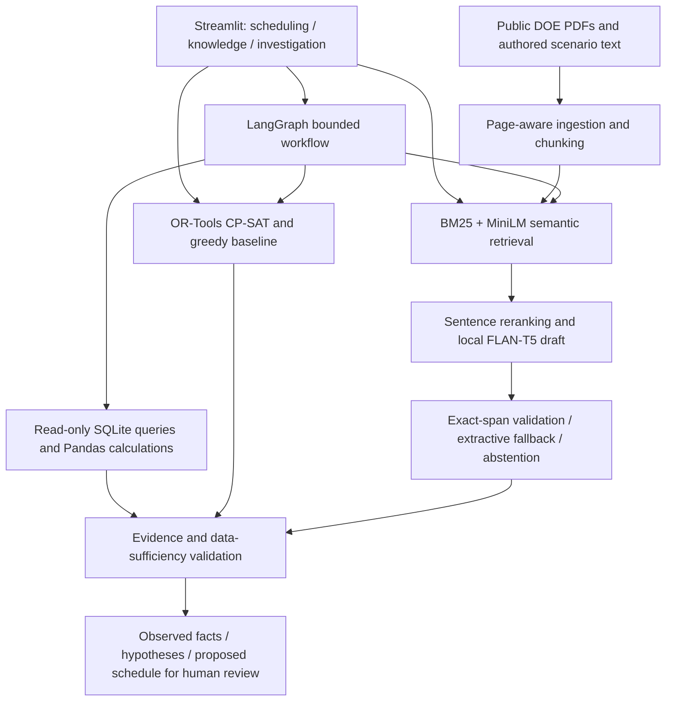

# OptiMind AI

A Python decision-support proof of concept combining constrained production scheduling, technical-document retrieval and a bounded LangGraph operations investigator. It demonstrates optimization, NLP, foundation-model inference, SQL/Pandas analysis and tool orchestration for industrial AI engineering roles.

**Executed results:** 14 scheduling instances, average 14.61% makespan reduction versus greedy; standard FT06 solved and proved optimal at 55 versus greedy 88. Hybrid document recall@3: 0.9722 on 18 answerable authored questions. Answerable keyword accuracy: 83.33%; all 4 unsupported questions abstained. Agent tool selection and independent numerical-reference checks: 100% on 12 authored scenarios. **31 tests passed.** These are small development evaluations, not deployment guarantees.

See [results/REPORT.md](results/REPORT.md), [phase log](results/PHASE_LOG.md), and [source terms](NOTICE.md). The initial weak generation experiment is preserved in results/knowledge_initial rather than hidden.

## Architecture



The investigator coordinates the same scheduling and knowledge modules exposed by the interface. It cannot change plant operations, execute document instructions, write investigative SQL or invent numerical results.

## Stack and decisions

| Technology | Purpose |
|---|---|
| Python 3.12, NumPy, Pandas | Modular implementation, seeded fixtures and analysis |
| OR-Tools CP-SAT | Integer starts/ends, interval exclusivity, crew capacity, bounds and proof status |
| SQLite | Portable structured records with parameterized read-only investigative queries |
| Scikit-learn | Tool-set accuracy and abstention precision/recall/F1; vector retrieval uses exact NumPy cosine similarity |
| rank-bm25 | BM25 keyword retrieval baseline |
| MiniLM-L6-v2, PyTorch, Transformers | Real 384-dimensional pretrained semantic embeddings, masked mean pooling and normalization |
| FLAN-T5-small | Local instruction-tuned 77M-parameter model for answer drafts; no API keys or per-token charges |
| LangGraph | Explicit Understand, Plan, Investigate, Validate, Optimize and Report stages |
| pypdf | PDF text extraction with real physical-page metadata |
| Matplotlib, Streamlit | Experiment figures and three-section interactive app |
| pytest, Git, GitHub Actions | Correctness checks, local version history and a CI workflow |

An exact matrix-vector search is sufficient for 36 chunks; FAISS would add a dependency without a useful scale benefit. No language model is fine-tuned. Real pretrained models run locally and their revisions/hashes are recorded. The bounded agent uses a documented deterministic routing policy, not open-ended model-selected tools. The LLM participates in document answers; arithmetic, schedule construction, validation and report numerics are conventional code.

On this machine, `./run_app.ps1` launches the app using the prepared workspace dependencies. After a portable installation, the same launcher prefers the project virtual environment.

## Install and prepare

From this project folder, using Python 3.12:

```powershell
python -m venv .venv
.venv\Scripts\Activate.ps1
python -m pip install -r requirements.txt
python -m scripts.bootstrap
python -m pytest -q
python -m streamlit run app/streamlit_app.py
```

Bootstrap creates the synthetic SQLite scenario, downloads two source PDFs and approximately 400 MB of local model weights, extracts passages and builds the embedding index. Model downloads are public and pinned; no account or API key is required. First preparation needs internet. Subsequent inference uses local files only. Do not enable remote model code: this project uses standard architectures with local safetensors.

The portable archive includes source, fixtures, prepared SQLite/index artifacts, measured reports and figures. Large model weights and original source PDFs are excluded. Run bootstrap after extracting the archive to obtain those assets. The existing local project folder already has them. Model and document provenance is in results/model_provenance.json and results/document_provenance.json.

`requirements-lock.txt` records the installed dependency closure used on Windows Python 3.12. For the CPU PyTorch build, add `--extra-index-url https://download.pytorch.org/whl/cpu` when installing that snapshot. The primary requirements file is a smaller direct-dependency specification. Installation here used workspace-only extracted wheels because of Windows sandbox pip temporary-file restrictions; no global Python environment was changed. CPU is the validated execution mode; CUDA acceleration was not benchmarked.

## Scheduling component

```powershell
python -m optimization.benchmark
```

The Scheduling app accepts a complete JSON instance with jobs, ordered operations, machine IDs, durations, release times, deadlines, optional hard deadlines, machine availability, blackouts and crew demand. Start with configs/demo_schedule.json. Each operation has a fixed machine and cannot be interrupted. All times are nonnegative integer time units; use consistent units. Demo production durations are minutes. A user-supplied horizon_limit can bound the planning window.

### Mathematical formulation

For operation (j,o), integer start S[j,o] and end E[j,o] obey E=S+duration. A mandatory interval represents machine occupation. Each job follows its ordered operation route. The objective is minimum Cmax, with Cmax equal to the maximum final job completion.

Constraints:

- S[j,o] is at least the job release time and machine available_from time.
- S[j,o+1] is at least E[j,o].
- Intervals on the same machine do not overlap each other or fixed maintenance blackouts.
- Concurrent operation crew demands sum to at most crew_capacity.
- If hard_deadline is true, final completion is at most the job deadline.
- Every operation ends within the chosen horizon. Without an explicit horizon, the latest release/availability/blackout end plus total processing duration is a safe serial upper bound.

Deadlines are soft by default. Weighted tardiness sum(weight[j] * max(0, completion[j]-deadline[j])) is reported as a diagnostic; it is **not the makespan objective**. Optimizing makespan may increase tardiness. Sequence-dependent setup, alternative-machine assignment, inventory and stochastic failures are not modeled.

The greedy baseline schedules the ready operation with the earliest feasible start, breaking ties by deadline, duration and job ID. It scans feasible integer time positions and checks both machine and shared-crew capacity. It can make locally attractive choices that delay a critical future route. Selecting machine operation order is combinatorial; a single dispatch rule cannot examine all interactions.

CP-SAT uses one search worker, seed 42 and a two-second per-instance benchmark limit. OPTIMAL means optimality was proved; FEASIBLE means a validated incumbent without proof; INFEASIBLE means the modeled constraints were proved inconsistent; UNKNOWN supplies no schedule. HEURISTIC_FAILED does not prove infeasibility. Every returned schedule is checked by an independent validator for completeness, durations, machine choice, releases, precedence, calendars, hard deadlines and crew capacity.

Benchmark data: 12 seeded synthetic instances (4x3, 8x4, 12x5 and 20x6 jobs/machines; three seeds each), the public Google 3-job example and standard FT06 from Google's public OR-Tools example. Inputs are saved with results. Gap to a proved optimum is (value-optimum)/optimum. Relative bound gap is (value-lower_bound)/value and is labeled separately. Runtime and proof status can vary with system load under a wall-time limit.

## Knowledge assistant

```powershell
python -m knowledge_assistant.ingestion
python -m knowledge_assistant.retrieval --build
python -m knowledge_assistant.generation "What is the scheduling objective?"
python -m knowledge_assistant.evaluation
```

Ingestion normalizes whitespace and repairs line-end hyphenation, preserves source hashes and creates 110-word windows with 20-word overlap. PDF page numbers are physical 1-based pages, not invented printed-page numbers. Plain text has page=null. Scanned PDFs require OCR and are outside this implementation. A third-party table reproduced by permission in one DOE tip sheet is excluded from extracted chunks. Read NOTICE.md for source-specific terms; original PDFs retain their notices.

BM25 ranks normalized keyword tokens. MiniLM encodes documents and questions using attention-mask mean pooling and L2 normalization; exact dot products provide cosine similarity. Hybrid retrieval uses reciprocal-rank fusion with constant 60, avoiding dependence on incompatible BM25/cosine score scales. Index manifests bind ordered chunk IDs to vectors so stale indexes are rejected.

The answer pipeline retrieves eight candidate chunks, checks lexical/semantic evidence sufficiency and unknown equipment identifiers, then reranks sentences with semantic similarity plus lexical overlap. Uppercase identifiers such as FEASIBLE help disambiguate near-identical status definitions. The best two sentences form the local model context. FLAN-T5-small uses deterministic greedy decoding and a 512-token input cap.

A generated answer is accepted only if it contains at least four content tokens and is an exact normalized span in selected evidence. Otherwise an explicitly labeled source-sentence fallback is returned. Both raw model output and validation mode are visible. This prevents asserting an unsupported paraphrase, but **exact quotation does not guarantee relevance or a complete answer**. A small model still selected poor text for some questions. Source IDs, real page metadata and quotes are attached by code; the model cannot invent them. Unsupported queries abstain before generation.

Evaluation uses 18 authored, source-reviewed answerable questions and four unsupported questions in experiments/retrieval_questions.json. Relevance is document-level: Recall@k counts distinct gold documents represented in the top-k chunks; Hit@k asks whether any gold document appeared; MRR@5 uses the first gold-document chunk. A question with several gold documents can have Hit@3=1 but Recall@3 below 1. Generation uses documented keyword alternatives, not an independent semantic judge. Citation checks require both an exact source span and a gold relevant document. These are development-set measurements; no independent human review or held-out industrial QA benchmark is claimed.

The final answerable keyword accuracy is 15/18. Three failed checks remain in the saved outputs, including an incomplete field-list answer, a truncated leak-detection phrase and an irrelevant compressed-air heading. The initial pipeline scored 10/18 and is preserved separately. Several implementation choices were improved using this same development set, so the change is not an unbiased test-set gain.

## Operations investigator

```powershell
python -m scripts.prepare_data
python -m operations_agent.workflow "Investigate production throughput and recommend a schedule" --with-schedule
python -m operations_agent.evaluation
```

The scenario contains 42 synthetic machine-shift rows: three machines over 14 days, seed 42. Defaults compare 5-11 October 2026 with 12-18 October 2026. Date fields are authoritative and explicit; relative dates and arbitrary date parsing are not implemented. These are fixed example periods, not a claim about the current week. The generator reduces M1 output, increases its downtime and inserts one missing M2 downtime value. This is a controlled fixture, not observed factory behavior.

SQLite stores planned/actual minutes, completed units, downtime, targets and scheduled minutes. Investigative connections use mode=ro plus PRAGMA query_only. SQL is fixed and parameterized; the language model never writes SQL. Pandas computes period totals, attainment, throughput, machine busy utilization, planned/actual summaries and known downtime. A missing value stays unknown. Coverage checks use the declared machine inventory, so a machine missing from both periods cannot disappear silently. Contradictions such as negative values or processing plus downtime exceeding a shift block confident conclusions.

The LangGraph sequence is:

1. Understand: validate the typed request and route the bounded supported intents.
2. Plan: select only required analysis, retrieval or scheduling tools.
3. Investigate: execute fixed tools and retain inputs, outputs, durations and errors.
4. Validate: check sufficiency, contradictions and required scheduling inputs.
5. Optimize: call the shared CP-SAT module when a schedule was requested, explicit constraints exist and dependent evidence passed validation.
6. Report: assemble calculated facts, citations, separately labeled hypotheses, proposed actions and a human-review schedule.

A knowledge-only question skips SQL and optimization; scheduling-only can operate without model assets. An empty analysis period blocks a dependent schedule and cannot be marked supported merely because generic reference text was retrieved. Missing schedule inputs are reported, not invented. Documents are evidence, never executable instructions. The workflow cannot execute a production change.

The 12-case agent suite measures exact tool-set/order selection, independent numerical-reference checks, support decisions, span citations, schedule feasibility, unnecessary tool calls and warm end-to-end latency. Reference totals are direct Python sums over original generator records, independent of the investigative SQL/Pandas path. Grounding checks trace structured observations and causal caveats; they are not full natural-language entailment judgments. Small rule-aware authored cases do not establish broad agent intelligence.

Observed fixture totals are 2,101 units before and 1,918 after, a decline of 183 (-8.71%). Known downtime sums are 643 and 1,236 minutes, but the latter has one missing record; it is not a complete total. The report identifies correlation and missingness without claiming a confirmed root cause.

## Interface and experiments

The three Streamlit sections display live calculated outputs, not hardcoded benchmark figures. Scheduling accepts editable JSON and compares Gantt charts; Knowledge shows answer mode, source passages and model drafts; Investigation exposes facts, hypotheses, limitations, validated schedule and execution trace. JSON reports can be downloaded.

```powershell
python -m scripts.run_experiments
python -m streamlit run app/streamlit_app.py
```

There are no paid API calls. Local memory and CPU time are the primary costs. Startup includes loading approximately 400 MB of model weights and is excluded from warm inference timing. No GPU latency claim is made. Streamlit tests exercise live scheduling, invalid input, SQL-only investigation and a real local-model answer.

## Repository and delivery

```text
optimization/           problem, greedy scheduler, CP-SAT, independent validation, benchmarks
knowledge_assistant/    PDF/text ingestion, BM25/semantic/hybrid retrieval, guarded local RAG
operations_agent/       LangGraph workflow, deterministic analysis and evaluation
database/              schema and read-only queries
app/                   integrated Streamlit interface
configs/               pinned models, experiments and example scheduling inputs
experiments/           inspectable question/gold-relevance fixtures
scripts/               preparation, asset downloads, experiments and packaging
tests/                 critical correctness and UI tests
results/               measured CSV/JSON, figures, provenance and reports
```

A local Git repository and initial commit are included in the working folder. Git ignores large model weights, caches and generated SQLite/index files. The archive includes prepared demo data/index for convenience but excludes Git metadata, original PDFs and model weights. A GitHub Actions workflow is supplied; it has not run on GitHub and no repository was published. CI runs unit tests, with model-dependent integration checks skipped unless their assets are present.

## Known limits and next work

Use a held-out industrial document collection and independent reviewers before relying on answers. Improve PDF layout extraction and use a stronger local model only after measuring cost/quality; validate support rather than equating quote existence with correctness. Expand agent intent coverage or add a constrained structured-output model planner with a fixed tool allowlist, while retaining deterministic numerical tools. Evaluate larger scheduling instances with reproducible time budgets, add machine alternatives/setup/material constraints when needed, and keep final evaluation sets separate from development. The current system proposes decisions for review and has no physical plant integration, causal diagnosis or production safety certification.
