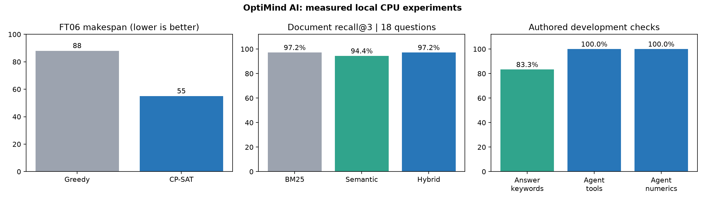
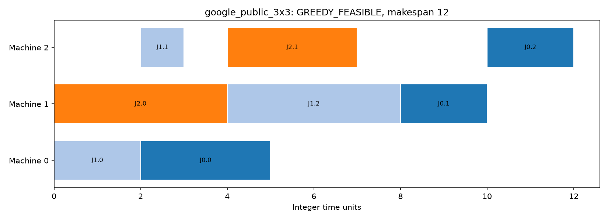
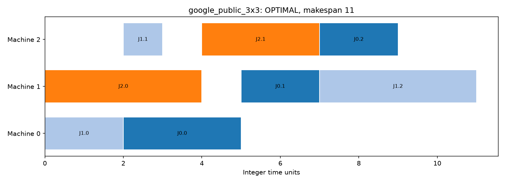
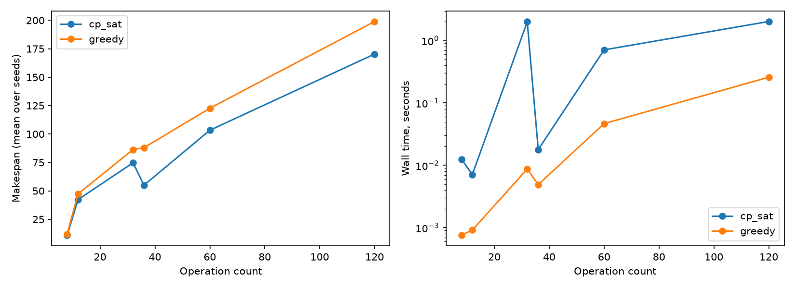
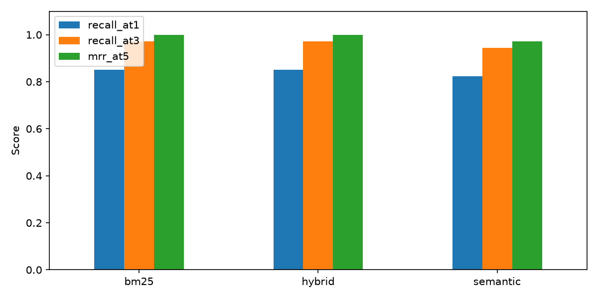
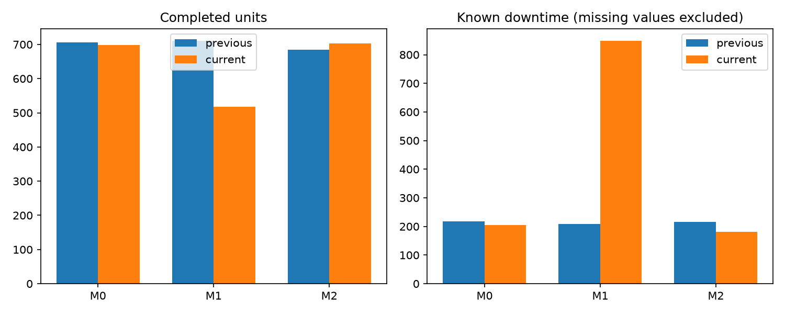
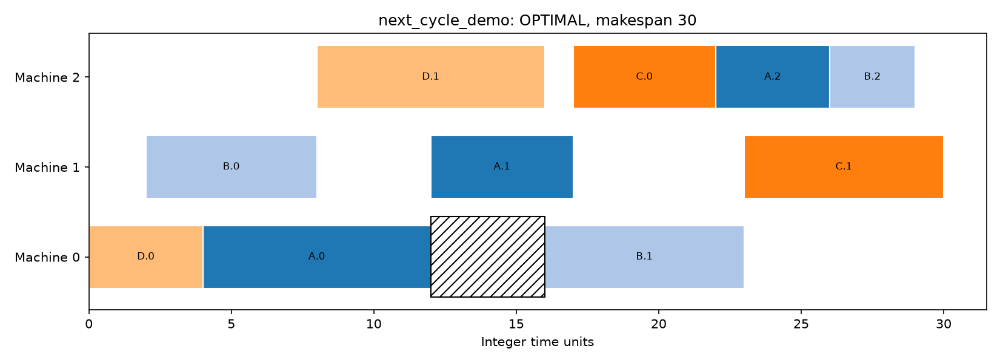

# OptiMind AI — measured execution report

Executed on 28 October 2026. All figures below were calculated by the supplied code. Production records are synthetic, scheduling includes public examples and synthetic instances, and technical PDFs come from public DOE sources. No real-plant savings, root cause or production deployment is claimed.

## Summary

- Scheduling: 14 instances, 14.61% mean makespan reduction over greedy, 7 CP-SAT optimality proofs, zero independently detected violations.
- FT06: greedy 88; CP-SAT 55 with an optimality proof. Google 3-job example: greedy 12; CP-SAT 11 with an optimality proof.
- Hybrid retrieval: Recall@3 0.9722, Hit@3 1.0000 and MRR@5 1.0000 on 18 answerable authored questions.
- Generation: 15/18 answerable keyword checks; 4/4 unsupported questions abstained; all answered citations match a gold source and an exact text span. Three answers accepted exact model spans; 15 used explicitly labeled extractive fallback.
- Agent: 12 authored scenarios; tool selection, independent numeric references, support decisions, citation-span checks and schedule feasibility all 100%; zero unnecessary calls under the documented policy.
- Tests: 31 run, 0 failures. See [verification](verification.json) and [pytest XML](pytest.xml).

## Hardware and reproducibility

Python 3.12.0; PyTorch 2.14.0+cpu; Windows-11-10.0.26200-SP0; Intel64 Family 6 Model 140 Stepping 1, GenuineIntel. CUDA available: False. CPU model inference uses two PyTorch threads. OR-Tools uses one search worker, seed 42 and a two-second benchmark budget. The 101-distribution Windows dependency snapshot is in requirements-lock.txt.

Pinned MiniLM revision: 1110a243fdf4706b3f48f1d95db1a4f5529b4d41. Pinned FLAN-T5 revision: 0fc9ddf78a1e988dac52e2dac162b0ede4fd74ab. No model was fine-tuned. Local weights are approximately 400 MB; first-run download and model-loading time are excluded from warm latency. Model and document SHA256 manifests are included. See README for commands and NOTICE.md for source terms.

## Scheduling measurements

| Instance | Greedy | CP-SAT | Solver status | Bound | Reduction |
|---|---:|---:|---|---:|---:|
| google_public_3x3 | 12 | 11 | OPTIMAL | 11 | 8.33% |
| ft06 | 88 | 55 | OPTIMAL | 55 | 37.50% |
| synthetic_4x3_42 | 44 | 39 | OPTIMAL | 39 | 11.36% |
| synthetic_4x3_43 | 43 | 39 | OPTIMAL | 39 | 9.30% |
| synthetic_4x3_44 | 55 | 49 | OPTIMAL | 49 | 10.91% |
| synthetic_8x4_42 | 95 | 76 | FEASIBLE | 68 | 20.00% |
| synthetic_8x4_43 | 77 | 71 | FEASIBLE | 63 | 7.79% |
| synthetic_8x4_44 | 87 | 77 | FEASIBLE | 74 | 11.49% |
| synthetic_12x5_42 | 118 | 105 | FEASIBLE | 95 | 11.02% |
| synthetic_12x5_43 | 140 | 103 | OPTIMAL | 103 | 26.43% |
| synthetic_12x5_44 | 110 | 102 | OPTIMAL | 102 | 7.27% |
| synthetic_20x6_42 | 194 | 165 | FEASIBLE | 158 | 14.95% |
| synthetic_20x6_43 | 209 | 178 | FEASIBLE | 168 | 14.83% |
| synthetic_20x6_44 | 194 | 168 | FEASIBLE | 159 | 13.40% |

The objective is makespan; deadlines are soft unless explicitly marked hard. Weighted tardiness is reported but not optimized. Releases, machine availability/blackouts, precedence and shared crew constraints are active in synthetic instances. The two public examples use their standard machine/precedence setup. All 28 schedules pass an independent validator. Test coverage includes exhaustive enumeration on a small instance, true infeasibility and a deliberately exhausted time budget returning UNKNOWN.

The greedy baseline is simple and faster on small inputs, but makes short-sighted dispatch choices. These timings reflect Python/CPU wall time and synthetic scale. FEASIBLE results have validated incumbents and valid lower bounds but are not proved optimal. Bound gaps and exact optimum gaps are separate CSV columns. Hard time limits can change incumbents with system load.

## Retrieval and local generation

The final corpus contains 36 overlapping chunks from six documents: two public DOE technical PDFs and four authored synthetic line/data/evidence policies. PDF page numbers are real 1-based physical pages; text has no page. A third-party leakage table is omitted from extraction. BM25, normalized MiniLM cosine search and reciprocal-rank fusion use the same chunks.

| Retrieval method | Recall@1 | Recall@3 | Recall@5 | Hit@3 | MRR@5 | Mean warm latency |
|---|---:|---:|---:|---:|---:|---:|
| bm25 | 0.8519 | 0.9722 | 0.9722 | 1.0000 | 1.0000 | 0.63 ms |
| semantic | 0.8241 | 0.9444 | 1.0000 | 1.0000 | 0.9722 | 28.14 ms |
| hybrid | 0.8519 | 0.9722 | 0.9722 | 1.0000 | 1.0000 | 28.42 ms |

Recall counts distinct relevant documents in top-k chunks. Several questions have more than one gold document. Hit@3 and MRR@5 can therefore be perfect while Recall@3 is lower. BM25 was already strong on this small technical corpus; embeddings are not claimed to improve it. Semantic retrieval recovered every gold document by k=5, while BM25/hybrid had higher MRR@5.

The generator creates a real deterministic FLAN-T5 draft from reranked evidence. Exact source-span validation accepts only sufficiently long supported spans; otherwise a visible extractive fallback is returned. Source citations are attached by code. These restrictions reduce unsupported assertions but cannot prove answer relevance. Raw model drafts and selected evidence remain inspectable. The pipeline does not send operational data to a remote service.

Final generation warm median latency: 1533.76 ms across all 22 questions, including the faster abstentions. Answerable keyword accuracy is 83.33%; overall keyword/abstention accuracy is 86.36%. Unsupported-question abstention precision, recall and F1 are all 1.0 on four positive abstention cases. This tiny, authored development set is not evidence of universal hallucination detection.

The initial pipeline scored 10/18 on answerable keyword checks. Sentence reranking, stricter draft guards and cleaner PDF text increased this to 15/18 on the same development set. The initial results are preserved under knowledge_initial. Because changes were developed against these questions, this is not an unbiased held-out improvement estimate. Gold source/keyword checks were authored and inspected against source text; no independent human adjudication is claimed.

### Remaining failed answer checks

| Case | Question | Returned primary answer |
|---|---|---|
| q10 | What fields are in each production shift record? | Each record represents one machine on one date, a single eight-hour shift. |
| q16 | What instrument detects compressed air leaks? | detector, which can recognize high frequency hissing sounds associated with air leaks. |
| q17 | Which variables determine annual compressed air energy cost? | Compressed AirMotorsSteam Suggested Actions |

These are real failures: an incomplete field list, a chunk-truncated leak-detection phrase and an irrelevant heading selected as a model span. Quotation/source correctness is narrower than full answer correctness. A stronger model, sentence-preserving chunking, improved PDF layout extraction and independent answer adjudication are justified next steps. No unsupported benchmark claim replaces these cases.

## Agent investigation

The 12 authored cases exercise analysis-only, retrieval-only, scheduling-only, combined investigation, explicit no-schedule requests, absent schedule inputs, empty periods, unsupported equipment and out-of-scope questions. Routing is an explicit bounded policy in a real LangGraph state machine. It is not a general-purpose language-model planner. Numerical report fields are calculated by deterministic SQL/Pandas tools, with independent direct-Python fixture references.

Final agent warm median latency: 68.90 ms; p95: 2124.27 ms. The median includes fast analysis-only and no-tool cases; it is not a combined-investigation latency claim. Exact per-case times/tool calls are saved in agent/evaluation.csv and individual JSON reports.

Observed synthetic fixture: 2,101 units in the previous seven-day period and 1,918 in the current period, -183 units (-8.71%). Known downtime is 643 versus 1,236 minutes. The current period has one missing downtime value, so that sum is explicitly incomplete. M1 supplies the main output decline in the generator-controlled scenario. A correlation does not prove a root cause; maintenance and sensor evidence are absent. No real-world causal conclusion is made.

The next-cycle scheduling instance is an explicit independent proposed workload, not a forecast inferred from the production records. The workflow validates the typed jobs and shared constraints before calling the existing solver and requires human review of the result. A missing period blocks dependent scheduling and the report cannot be marked supported by generic retrieved advice alone. Tool errors, inputs, outputs and durations are exposed.

## Verification, packaging and limits

The test suite exercises independent optimum checks, cumulative resources, blackouts, invalid durations/calendars, missing/tampered operations, read-only writes, empty and contradictory data, absent machines, fabricated LLM answers, exact citations, pre-generation abstention, selective routing, missing-data schedule blocking, actual solver UI results, invalid JSON, SQL-only UI analysis and a real local-model UI answer. The upstream LangChain pending-deprecation warning does not affect the observed passing tests.

The portable archive includes source, configurations, prepared demo SQLite/index, provenance, results and figures. It excludes original PDFs, large model weights, caches and Git metadata. Run scripts.bootstrap to retrieve excluded assets. A local Git commit is created; a GitHub Actions workflow is supplied, but publication and remote CI execution are pending. See [phase log](PHASE_LOG.md) for files, commands, outcomes and problems by phase.

Remaining scope limits: synthetic production data, small development sets, no independent human QA review, rule-bounded intent coverage, imperfect PDF extraction, extractive fallback dependence, fixed-route scheduling and wall-time-dependent incumbents. No deployment, physical machinery control, confirmed industrial root cause or real-plant economic benefit is claimed.
